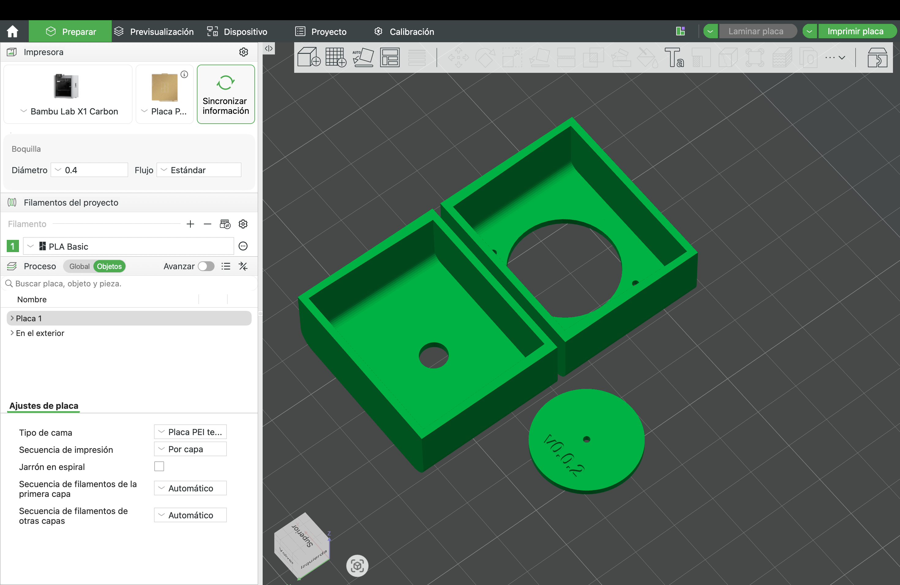

# Semana-13

## Resumen de días, temas y horas

| Fecha      | Día      | Temas                                                | Lugar     | Horas día / hora semana |
| :--------- | :------- | :--------------------------------------------------- | :-------- | :---------------------- |
| 2026-10-19 | Lunes    |                                                      |           | 000 / 000               |
| 2026-10-20 | Martes   |                                                      |           | 000 / 000               |
| 2026-10-22 | Jueves   |                                                      |           | 000 / 000               |
| 2026-10-23 | Viernes  |                                                      |           | 000 / 000               |
| 2026-10-24 | Sábado   |                                                      |           | 000 / 000               |
| 2026-10-25 | Domingo  |                                                      |           | 000 / 000               |

## Tacto 48

### Molde para las perforaciones

Hoy modifiqué los moldes que diseñé la semana pasada para perforar la caja de aluminio 1590A, en el repositorio de **[Tacto 48](https://github.com/Bernardita-Jesus/tacto48/tree/main/modelado-caja)**. Los moldes son dos tapas impresas en 3D, una para cada extremo de la caja, que entran por el extremo y abrazan los cuatro lados con una falda de 15 mm, para que no se muevan mientras marco y perforo.

En la primera versión, cada perforación tenía solo un agujero chico para marcar el centro y un anillo grabado con el diámetro final. Ahora separé las perforaciones según su tamaño:

- **Perforaciones grandes:** El jack (6,2 mm) y el círculo del XLR (24,2 mm) quedan abiertos a su diámetro final, así veo directamente en la caja el contorno exacto de cada perforación.

- **Perforaciones chicas:** Los dos tornillos M3 del XLR mantienen el agujero de 1,5 mm para marcar el centro con punzón y el anillo grabado con el diámetro final.

- **Disco del XLR:** Como el círculo del XLR queda abierto, diseñé una pieza aparte, un disco de 23,8 mm que calza dentro del círculo con 0,2 mm de tolerancia por lado. Tiene un agujero al centro para marcar con punzón y se saca después de marcar.

En el código agregué dos constantes nuevas: **PLANTILLA_DIAMETRO_ABIERTO**, que define desde qué diámetro una perforación queda abierta (5 mm), y **DISCO_TOLERANCIA**, el juego entre el disco y el círculo, que puedo subir si el disco no entra o bajar si queda suelto. El disco también lleva grabada la versión **v0.0.2**.

En la siguiente captura se pueden ver los moldes del jack y del XLR, junto al disco del XLR con la versión **v0.0.2** grabada, listos para imprimir en Bambu Studio con la Bambu Lab X1 Carbon y PLA.

#### Cómo se usa

1. Pongo el molde del jack en un extremo de la caja y el molde del XLR en el otro.

2. En el extremo del jack, marco el contorno de la perforación abierta.

3. En el extremo del XLR, pongo el disco dentro del círculo, marco el centro con punzón y saco el disco.

4. Marco con punzón los dos tornillos del XLR.

5. Saco los moldes y perforo primero con la broca guía de 2 mm, y después con la broca de cada medida.

Los archivos para imprimir están en la carpeta **stl**: la plantilla del jack, la plantilla del XLR y el disco del XLR.
