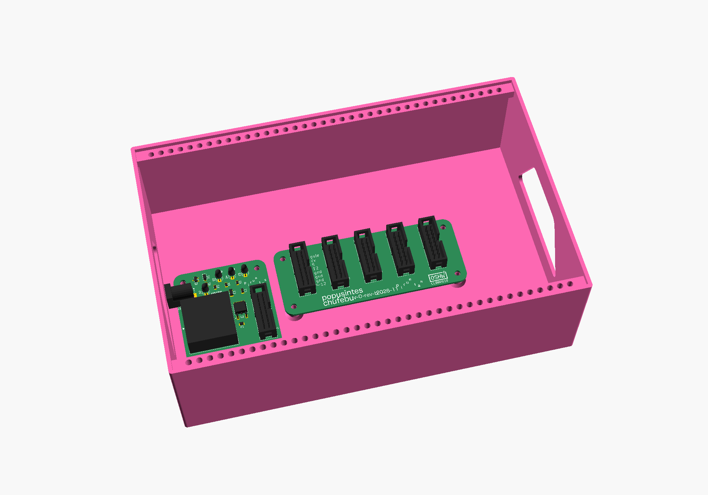

# Semana-18

## Resumen de días, temas y horas

| Fecha      | Día      | Temas                                                | Lugar     | Horas día / hora semana |
| :--------- | :------- | :--------------------------------------------------- | :-------- | :---------------------- |
| 2026-11-23 | Lunes    | Registro, Fabricación                                | LID       | 006 / 006               |
| 2026-11-24 | Martes   |                                                      |           | 000 / 000               |
| 2026-11-26 | Jueves   |                                                      |           | 000 / 000               |
| 2026-11-27 | Viernes  |                                                      |           | 000 / 000               |
| 2026-11-28 | Sábado   |                                                      |           | 000 / 000               |
| 2026-11-29 | Domingo  |                                                      |           | 000 / 000               |

## Montaje de los botes

Montamos en los **botes** la **fuente de poder** y las **entradas para los módulos Eurorack**. La fuente **chufe** y el bus **chufebu** se atornillan en los postes del piso de la caja, que agregamos en la versión **v0.1 rev-d**.

En la siguiente captura se puede ver un render del bote v0.1 rev-d visto desde arriba, con las dos placas montadas sobre sus postes y sus componentes reales, exportados desde los diseños en **KiCad**. A la izquierda está la fuente de poder **[chufe](https://github.com/piruetasxyz/chufe)** v0 rev-b, con el jack de alimentación hacia el agujero de la pared, el convertidor de voltaje (el bloque negro grande), los LED y un conector de poder Eurorack. A su derecha está el bus **[chufebu](https://github.com/piruetasxyz/chufebu)** v0 rev-b, con **cinco conectores IDC de 2 × 8 pines**, que son las entradas de poder para los módulos Eurorack.

